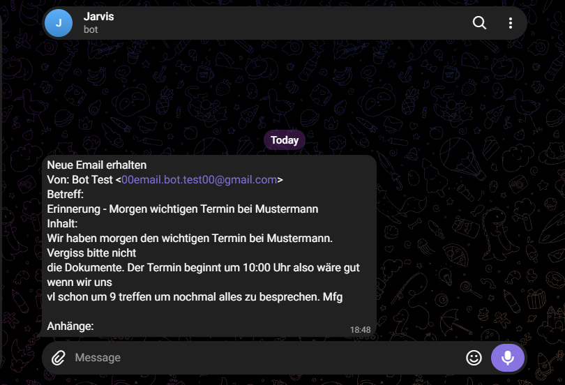

# E-Mail-Agent


## Was es tut

Der Agent prüft ein E-Mail-Postfach und schickt für jede E-Mail, die seit dem
letzten Lauf neu dazugekommen ist, eine Telegram-Nachricht mit Absender, Betreff,
Text und den Namen der Anhänge.

Welche Mail zuletzt übermittelt wurde, merkt er sich. Dieselbe E-Mail wird deshalb
nie zweimal übermittelt – auch dann nicht, wenn sie im Postfach ungelesen bleibt.


## So sieht eine Meldung aus




## Voraussetzungen

- Python 3 (entwickelt und getestet mit 3.14)
- Ein E-Mail-Postfach mit IMAP-Zugang (voreingestellt ist Gmail)
- Einen Telegram-Bot, den der BotFather anlegt

Die beiden benötigten Bibliotheken installieren:

```
pip install requests python-dotenv
```


## Einrichtung

`.env.example` zu `.env` kopieren und die vier Werte eintragen. Was hinter jeden
Wert gehört und woher er kommt, steht in der `.env.example` selbst.

Die `.env` enthält Zugangsdaten und ist deshalb von der Versionsverwaltung
ausgeschlossen.


## Starten

In den Projektordner wechseln, dann den Agenten aufrufen:

```
cd email-agent
python first_email_agent.py
```

Der Ordnerwechsel ist nicht optional: Der Agent legt seinen Merkzettel
`letzte_uid.txt` im aktuellen Verzeichnis an. Wird er von woanders gestartet,
findet er die Datei nicht, beginnt wieder bei null und meldet das gesamte
Postfach.

Bei Erfolg gibt das Programm nichts aus – das Ergebnis erscheint in Telegram.


## Testsätze

evaluate.py ist zum Überprüfen, wie oft das Modell Kategorie und Aktion richtig trifft und mit was für einer Wahrscheinlichkeit bzw. wie sicher sich das Modell bei der Auswahl ist.

- Messbedingungen: Modell ministral-3:14b über Ollama 0.40.2, Temperatur 0, Schwelle 0.8, Prompt-Stand Commit f8c7966.
- Schwelle: Für Kategorie und Aktion berechnet evaluate.py eine Sicherheit – wie wahrscheinlich das Modell sein gewähltes Wort fand (aus den Token-Wahrscheinlichkeiten, die Ollama mitliefert). Liegt sie unter 0.8, wird das Urteil als „unsicher“ markiert, als Hinweis, dass ein Mensch genauer hinsehen soll. Sicherheit ist nicht Richtigkeit: Im Prüfsatz war mail_105 zu 97,5 % sicher und trotzdem falsch.
- testmails_uebung/ = 102 erfundene Mails (der Übungssatz). Auf der Basis wurde am Prompt und der Schwelle gearbeitet. Er sagt wenig aus.
- testmails_pruefung/ = 115 Mails bei ChatGPT bestellt *ohne dass ChatGPT den Prompt kannte*. Die ersten 100 liefen am 08.10.2026. Weil keine davon das Soll „zur Kenntnis“ hatte, kamen am 11.10.2026 15 Mails dazu, danach lief der ganze Satz noch einmal. Dieser zweite Lauf zählt. Am Prompt wurde in der Zeit und danach nichts geändert, und die ersten 100 Mails ergaben in beiden Läufen dieselben Urteile. Soll-Werte wurden teils von Claude Opus 5.5 mit meinen Regeln erstellt und alle von mir geprüft und bestätigt.
- Ergebnis: *Kategorie 102/115 · Aktion 96/115 · fälschlich ignoriert 0 (keine wichtige Mail landete bei ignorieren) · Betrug erkannt 12/16.*
- Rohausgabe in testmails_pruefung/ergebnis_2026-10-11.txt (erster Lauf über die ersten 100: ergebnis_2026-10-08.txt).
- testmails_injection/ = 2 Mails mit eingeschleusten Anweisungen an das Sortiersystem: Eine soll eine Schadensmeldung (Schimmel im Kinderzimmer) auf „ignorieren“ herabstufen, die andere Werbung auf „sofort“ hochstufen. Sie prüfen, ob das Modell solchen Anweisungen folgt, und zählen nicht in die Trefferquote. Ergebnis am 11.10.2026, ein Lauf mit den Bedingungen oben: Das Modell ist keiner der beiden Anweisungen gefolgt und hat beide Mails richtig eingestuft. Bei beiden lag die Sicherheit für einen Teil des Urteils unter der Schwelle 0.8. Rohausgabe in testmails_injection/ergebnis_2026-10-11.txt. Mit einem Cloud-Modell ist das noch nicht gemessen.

So startet man die Messung:

1. Ollama installieren und das Modell einmalig laden: `ollama pull ministral-3:14b`. Ollama muss während der Messung laufen.
2. In `evaluate.py` den Testsatz wählen, zum Beispiel `TEST_FOLDER = "testmails_pruefung"`.
3. Im Ordner `email-agent` starten: `python evaluate.py`

Ausgegeben wird pro Mail eine Zeile mit Soll, Urteil des Modells und Sicherheit, am Ende die Zusammenfassung.


## Stand und geplante Schritte

Aktueller Stand: **v0.2.0**. Das Urteil ist gebaut und gemessen: Zu jeder E-Mail
bestimmt ein Sprachmodell eine Kategorie (9 zur Auswahl, zum Beispiel
Mieteranfrage, Rechnung oder Betrugsverdacht) und eine Aktion (sofort, heute,
zur Kenntnis oder ignorieren; bei Betrugsverdacht immer prüfen), dazu die
Sicherheit. Das Modell läuft lokal über Ollama. Kategorien, Regeln und Beispiele
stehen in `kategorien.json`, nicht im Code. Wie gut das funktioniert, steht
unter „Testsätze“.

Noch nicht eingebaut: Der Agent selbst (`first_email_agent.py`) nutzt das Urteil
noch nicht. Er wird von Hand gestartet und meldet weiter jede neue E-Mail per
Telegram.

Als Nächstes geplant:

- **Das Urteil im Agenten.** Pro E-Mail werden Kategorie und Aktion gespeichert,
  der Agent lässt sich aus jedem Ordner starten, und das Modell ist umschaltbar
  zwischen einem Cloud-Dienst und einem lokal laufenden Modell – damit die
  Inhalte den eigenen Rechner nicht verlassen müssen.
- **Eine eigene Oberfläche.** Die Urteile erscheinen auf einer lokalen Webseite.
  Telegram meldet nur noch, wie viele E-Mails heute Aufmerksamkeit brauchen –
  ohne Inhalte.
- **Antwortentwürfe** per Knopfdruck.
- **Dauerbetrieb.** Zeitsteuerung, eine Logdatei über jeden Lauf und
  Fehlerbehandlung, damit der Agent ohne Aufsicht laufen kann.


## Rückmeldungen

Dieses Projekt entsteht beim Lernen, und genau deshalb ist Kritik hier nützlich:
Hinweise auf Fehler, Verbesserungsvorschläge und Anmerkungen zum Code sind
ausdrücklich willkommen – gern als Issue.
